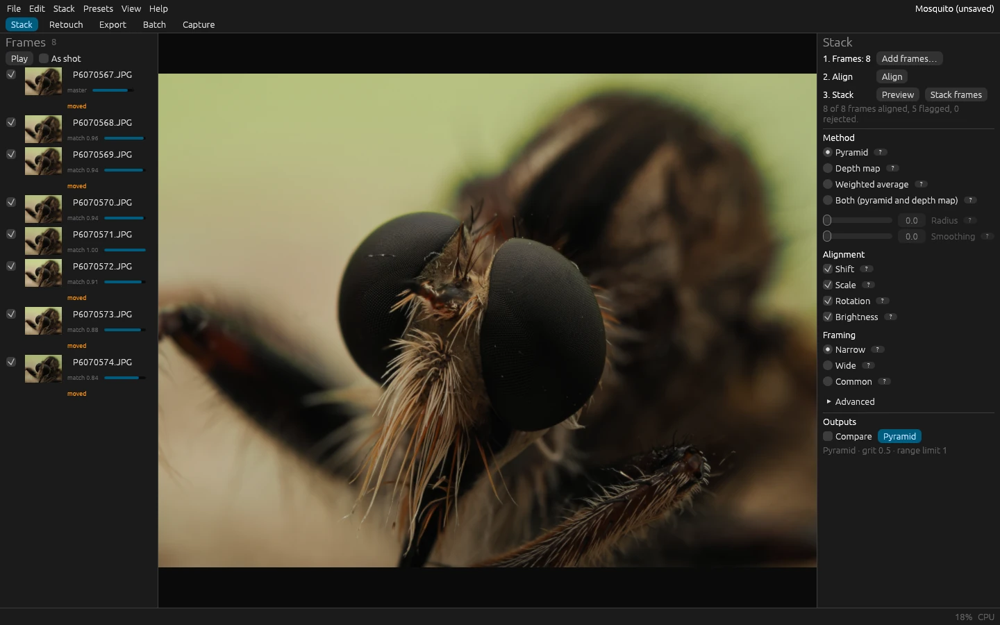
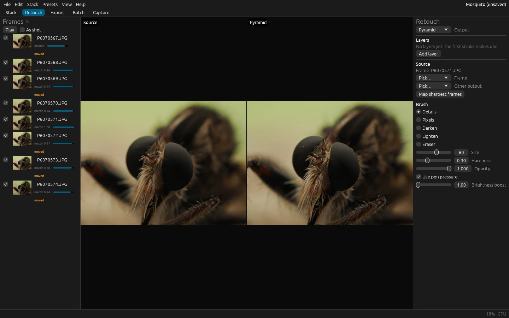
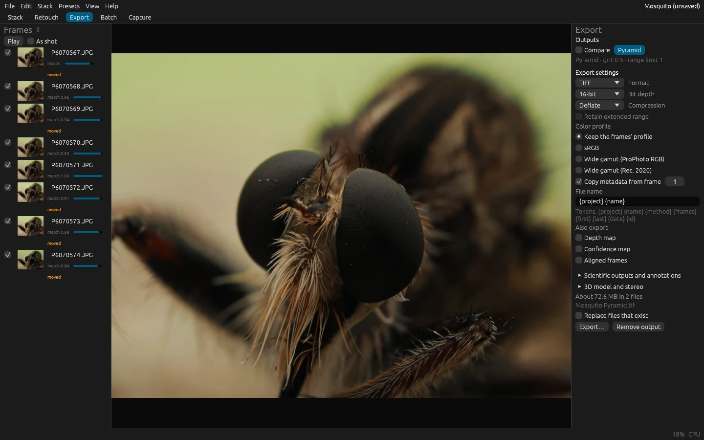

# FloraStack

FloraStack is a free, open-source focus-stacking application written in pure Rust. It aligns a series of photos
focused at different distances and merges the sharp parts of each into one image with more depth of field than any
single exposure allows, for macro, microscopy, product and landscape photography.



| Retouching from the frames | Exporting |
|---|---|
|  |  |

*Screenshots of the desktop app, rendered offscreen through its control channel by
[`scripts/readme_screenshots.py`](scripts/readme_screenshots.py). The photos are the maintainer's, under
[CC BY 4.0](https://creativecommons.org/licenses/by/4.0/).*

- **Four stacking methods**: the pyramid for hair, bristles and overlapping detail, the depth map for smooth subjects
  and exact tones, a fast weighted average, and a slower wavelet method for the last bit of fine detail, with
  quarter-size previews in seconds and slabbing for stacks of hundreds of frames.
- **Alignment** of shift, scale, rotation and brightness, with each frame's match shown, frames that moved or are out
  of focus flagged, sensor dust and hot pixels painted out, and stacks that were shot out of order sorted.
- **Non-destructive retouching**: paint from any frame onto the result, with brushes that match brightness and color,
  in layers, with full undo.
- **Camera RAW** files developed linearly for the whole stack, and TIFF, JPEG, PNG, WebP, OpenEXR and DNG out with
  their metadata; depth and confidence maps, calibrated depth, scale bars, 3D reliefs and stereo pairs.
- **Batches, watch folders and tethered capture**, a command-line tool, MCP and Python bindings, all over the same
  engine commands.
- **On the GPU** when one passes a self-test, on the CPU otherwise, in memory that depends on the image size, not the
  number of frames. FloraStack sends nothing anywhere: no telemetry.
- **In a browser** too: the same app compiled to WebAssembly, stacking on the page's threads or with WebGPU, as a
  static site you can host yourself, with a Dockerfile to serve it ([In the browser](book/src/user/browser.md)).

FloraStack is in early development. Its release workflow builds packages for Windows, macOS and Linux from each
version tag.

## Getting started

[Install FloraStack](book/src/user/install.md), drop a folder of photos on its window, press **Align**, then **Stack
frames**: [Your first stack in five minutes](book/src/user/first-stack.md) walks through it. From a terminal:

```sh
florastack-cli stack path/to/photos --out result.tif
```

## Documentation

The guide is an mdBook in [`book/`](book/src/SUMMARY.md):

- **User guide**: [installing](book/src/user/install.md), [in the browser](book/src/user/browser.md),
  [a first stack](book/src/user/first-stack.md),
  [choosing a method](book/src/user/methods.md), [retouching](book/src/user/retouching.md),
  [slabbing](book/src/user/slabbing.md), [shooting advice](book/src/user/shooting.md),
  [batch and watch folders](book/src/user/batch-and-watch.md), [capture](book/src/user/capture.md),
  [scientific exports](book/src/user/scientific-exports.md), [automation, MCP and Python](book/src/user/automation.md)
  and [troubleshooting](book/src/user/troubleshooting.md).
- **Reference**: [the command-line tool](book/src/reference/cli.md) and every
  [engine command](book/src/reference/commands.md).
- **Developer guide**: [architecture](book/src/dev/architecture.md), [the command registry](book/src/dev/commands.md),
  [the CPU oracle for GPU code](book/src/dev/cpu-oracle.md), [adding a stacking method](book/src/dev/new-method.md),
  [the quality gate](book/src/dev/quality.md), [the LightCraft dependency](book/src/dev/lightcraft.md),
  [releasing](book/src/dev/packaging.md) and [the browser build](book/src/dev/web.md).

`cargo xtask book` builds it into `target/book/` and checks its links.

## Building

Install [rustup](https://rustup.rs). The toolchain is pinned in `rust-toolchain.toml`, and rustup installs it on first
use (or run `rustup toolchain install` in this folder). On Windows you also need the Visual Studio C++ build tools
("Desktop development with C++"). The first build downloads LightCraft's image crates from GitHub, where they are
pinned to one commit ([`book/src/dev/lightcraft.md`](book/src/dev/lightcraft.md)), so it needs network access; later
builds use Cargo's copy.

Workspace builds and checks also need Python 3.9+ and its development library for the separate Python extension;
`PYO3_PYTHON` selects the interpreter. Building only the desktop app or CLI with `-p` does not require Python.

```sh
cargo build --workspace                                 # build everything
cargo run -p florastack --release                       # the desktop app
cargo run -p florastack-cli --release -- --help         # the command-line tool
cargo test --workspace                                  # run the tests
cargo clippy --workspace --all-targets -- -D warnings   # lint (Clippy pedantic, warnings are errors)
cargo fmt --all --check                                 # check formatting
cargo xtask check-layers                                # check which crate may depend on which
cargo xtask ci                                          # everything CI runs, with a summary of skipped tests
cargo xtask corpus                                      # download the sample stacks and test fixtures pinned in corpus/manifest.toml
cargo xtask bench                                       # criterion benchmarks and the CPU-against-GPU run, summarized in target/bench-summary.json
cargo xtask quality                                     # every method on every stack: a report with crops in target/quality/, and the regression gate
cargo xtask book                                        # the user and developer guide, in target/book/, with every link checked
cargo xtask dist                                        # the release packages of this platform, in target/dist/<target>/artifacts/
cargo xtask web --serve                                 # the browser version, in target/web-site/, served on http://127.0.0.1:8080/
```

`cargo xtask ci` also runs `cargo deny check` (the license and dependency policy in `deny.toml`), `cargo audit` and
`cargo xtask book`; install their tools once with `cargo install --locked cargo-deny cargo-audit`, and mdBook and lychee
as `cargo xtask book --help` says. It ends with the browser build's headless test, which needs the nightly toolchain
and the wasm-bindgen CLI that `cargo xtask web --help` names, Node.js and Chrome or Edge
([The browser build](book/src/dev/web.md)). `cargo xtask corpus` downloads with `curl` and unpacks archives with `tar`, which
come with Windows 10 and later, macOS and most Linux systems; `cargo xtask ci` runs `cargo xtask corpus --fixtures`
before the tests, so that the codec and RAW tests have their files (about 110 MB the first time, nearly all of it
camera RAW samples). [`corpus/README.md`](corpus/README.md) explains the test corpus and how to add your own stacks.
[Tests, the corpus and the quality gate](book/src/dev/quality.md) explains `cargo xtask quality`, and
[Packaging and releasing](book/src/dev/packaging.md) `cargo xtask dist`.

Linux and macOS builds can add built-in camera control with `--features gphoto` and a separately installed libgphoto2
([Capture](book/src/user/capture.md)); Windows builds use the camera maker's tethering app and a watch folder instead.

## Contributing

Read [CONTRIBUTING.md](CONTRIBUTING.md) and [AGENTS.md](AGENTS.md) first: the rules every change follows, for human
contributors and AI coding agents alike. [docs/ROADMAP.md](docs/ROADMAP.md) tracks what is done and what comes next,
and [SECURITY.md](SECURITY.md) says how to report a vulnerability and how the file readers are fuzzed.

## License

Licensed under either of the [Apache License, Version 2.0](LICENSE-APACHE) or the [MIT license](LICENSE-MIT), at your
option.

Unless you explicitly state otherwise, any contribution intentionally submitted for inclusion in FloraStack by you, as
defined in the Apache-2.0 license, shall be dual licensed as above, without any additional terms or conditions.
