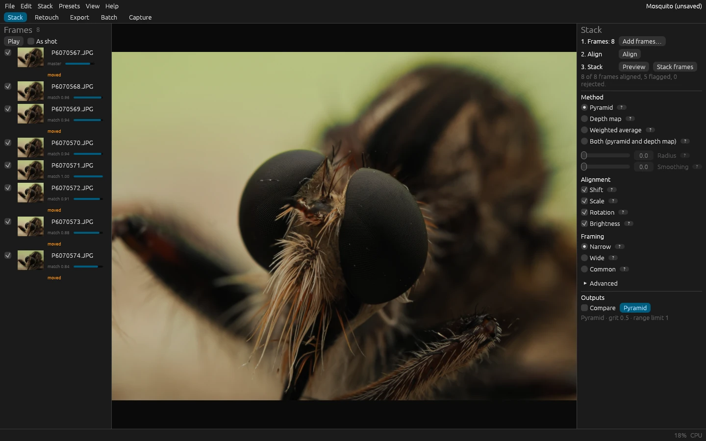

# FloraStack

FloraStack is a free, open-source focus-stacking application. It aligns a series of photos focused at different
distances and merges the sharp parts of each into one image with more depth of field than any single exposure allows:
for macro, microscopy, product and landscape photography.

It comes as a desktop app, a command-line tool and a Python package, all three over the same engine, so whatever one
of them does the others can too. It runs on Windows, macOS and Linux, on the GPU when one passes its self-test and on
the CPU otherwise. It sends nothing anywhere: no telemetry, no usage statistics, no crash reports, no update checks.

## This guide

- The **user guide** starts with [installing FloraStack](user/install.md) and [a first stack](user/first-stack.md),
  then explains [the stacking methods](user/methods.md) and every part of the app, how to
  [shoot a stack](user/shooting.md) that stacks well, and what to do when a result
  [doesn't look right](user/troubleshooting.md).
- The **reference** lists [the command-line tool's options](reference/cli.md) and every
  [engine command](reference/commands.md), the operations that scripts, the command palette and MCP clients call.
- The **developer guide** is for contributors: [how the code is organized](dev/architecture.md), the rules it follows,
  and how to [add a stacking method](dev/new-method.md), check quality, and [release](dev/packaging.md).

The source code, the issue tracker and the releases are on
[GitHub](https://github.com/gabrielsanchez/florastack). FloraStack is licensed under the MIT license or the Apache
License, Version 2.0, at your option.

The photos in this guide are crops and screenshots of stacks shot by the project's maintainer (gabrielsanchez) on an
OM System OM-1 Mark II with the M.Zuiko 60mm f/2.8 Macro, licensed under
[CC BY 4.0](https://creativecommons.org/licenses/by/4.0/).
