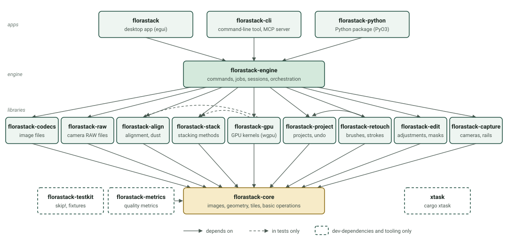

# Architecture

FloraStack is a Rust workspace: an engine made of library crates, and three thin front ends over it. Everything the
apps do goes through the engine's commands, so the desktop app, the command-line tool, the Python package, MCP clients
and scripts all have the same abilities, and the logic is tested once, headless.

[AGENTS.md](https://github.com/gabrielsanchez/florastack/blob/main/AGENTS.md) is the rule book every change follows:
its crate map, the layering, the never-crash and clean-room rules, and the per-change checklist. This chapter is the
tour; read AGENTS.md before your first change.

## The crates

- **Core** (`florastack-core`) holds what everything shares: image buffers and pixel formats, geometry, the tiled view
  and tile cache that let stacks exceed memory, progress and cancellation (`Monitor`), the basic operations (blur,
  resize, Laplacian, warps) and the product's identity from `branding.toml`. It depends on no FloraStack crate.
- **Libraries**, each on the core alone (the retouching crate on the project model too, the adjusting crate on the
  SAM 3 crate, which needs neither):
  - `florastack-codecs` reads and writes image files with their metadata and color profiles, and
    `florastack-raw` decodes and develops camera RAW files, both over [LightCraft](lightcraft.md)'s crates, kept
    behind FloraStack's own types.
  - `florastack-align` aligns frames to each other, orders and frames the stack, finds dust and movement, and splits
    batches into stacks. `florastack-stack` holds the stacking methods, streaming a frame at a time.
    `florastack-gpu` runs the hot paths of both on the GPU, each kernel checked against its
    [CPU reference](cpu-oracle.md).
  - `florastack-project` is the project model and its folder, with every change a value that can be undone.
    `florastack-retouch` paints brush strokes. `florastack-edit` renders the adjustments and masks users make to an
    output, with LightCraft's develop pipeline, and `florastack-sam` runs Meta's SAM 3 model for its AI selections. `florastack-capture` talks to cameras and rails.
- **The engine** (`florastack-engine`) ties them together: the command registry, the session that holds the open
  project and its undo history, the job engine, and the orchestration of a stack from files to export.
- **The apps** (`florastack`, the egui desktop app; `florastack-cli`; `florastack-python`) depend on the engine alone.
  They parse input, dispatch commands and show state; pure view state (zoom, pan, the open tab) is all they keep.
- **Tooling**: `florastack-metrics` (image-quality measures) and `florastack-testkit` (`skip!`, fixture lookup) are
  dev-dependencies only, and `xtask` runs the checks, the quality report and the packaging.

`cargo xtask check-layers` enforces these edges (the `RULES` in `xtask/src/layers.rs`): a crate may depend only on the
workspace crates its row allows, only the desktop app may use a UI toolkit, and the test-only crates never ship. A test
keeps this diagram's crates and those rules the same.

## A stack, from files to export

1. **Frames.** `project.addFrames` records each file with its size, time and hash. The engine reads a frame through
   `florastack-raw` (camera RAW and DNG) or `florastack-codecs` (everything else). RAW frames are developed with one set
   of settings for the whole stack, resolved once on a reference frame, into linear Rec. 2020; other files are
   linearized from their profile.
2. **Alignment.** `align.run` reduces the frames to a working size and estimates each one's shift, scale, rotation and
   brightness gain against its neighbor (a phase-correlation guess, then ECC refinement coarse to fine), chained to a
   master frame, with flags for limits, low scores, repeating patterns, frames out of focus and movement. It orders
   the stack from its narrow end and works out the output's canvas for each framing. The results are stored in the
   project.
3. **Stacking.** A stacking command plans a job from a snapshot of the project. Its worker reads each frame, and as the
   method asks for a rectangle of it, warps that rectangle onto the canvas: a frame is never held whole on the canvas.
   The method (a `Stacker`, on the CPU or the GPU) folds it into accumulators kept tile by tile within a memory
   budget, spilling to disk beyond it, so memory depends on the canvas, not the depth of the stack. The result is a
   new output, cached in the project folder.
4. **Retouching** records strokes as values (brush, settings, source, path) in the project and paints them over the
   output, the same pixels every time.
5. **Export** writes the output through `florastack-codecs` with a frame's metadata, the requested maps and aligned
   frames, and a JSON sidecar from which `export.reproduce` makes it again.

## Projects

A project is a folder, `<name>.florastack/`:

- `project.json`: the frames, alignment, outputs with their retouch and annotation layers, and preferences; versioned,
  with migrations from older versions.
- `cache/` and `previews/`: developed frames, results and previews, each referred to from `project.json` by path, size
  and SHA-256, and keyed by what it was made from, so that nothing is computed twice and nothing stale is used.
- A lock file, so that two processes never edit one project.

Changes are values (`Edit`) applied by `Session::apply`, each with its inverse, which is what undo applies. A command's
edits are one undo step.

## Commands and jobs

Every user-facing action is a named command in the engine's registry with a JSON schema for its parameters and
result: [The command registry](commands.md) says how to add one, and the [engine commands](../reference/commands.md)
page lists them all. A long command is a job: it plans on the engine's thread from a snapshot, runs on a worker,
reports progress and stops at checkpoints when cancelled, and returns a commit that the engine applies. Jobs run on
lanes: **heavy** (alignment and stacking, one at a time by default), **preview** (quick previews alongside, on a smaller
share of the machine) and **device** (camera and rail I/O, one operation at a time).

## Threads and determinism

Pixel work uses rayon's parallel iterators over rows, tiles and frames. Results never depend on scheduling: a tile's
fold reads only that tile, and every per-pixel sum runs over the frames in their order, so a stack is the same bit for
bit whatever the number of threads, for the same frames in the same order with the same settings. GPU results agree
with the CPU's within documented tolerances.

## Where to start reading

- `crates/engine/src/commands/` for what the app can do, one file per area.
- `crates/stack/src/lib.rs` and `crates/align/src/lib.rs`, whose crate documentation explains the algorithms and the
  papers they come from.
- `apps/florastack/src/app.rs` for the desktop app's state and actions, and `tests/smoke.rs` for how it is driven in
  tests.
- `cargo doc --workspace --no-deps --open` for the whole API.
