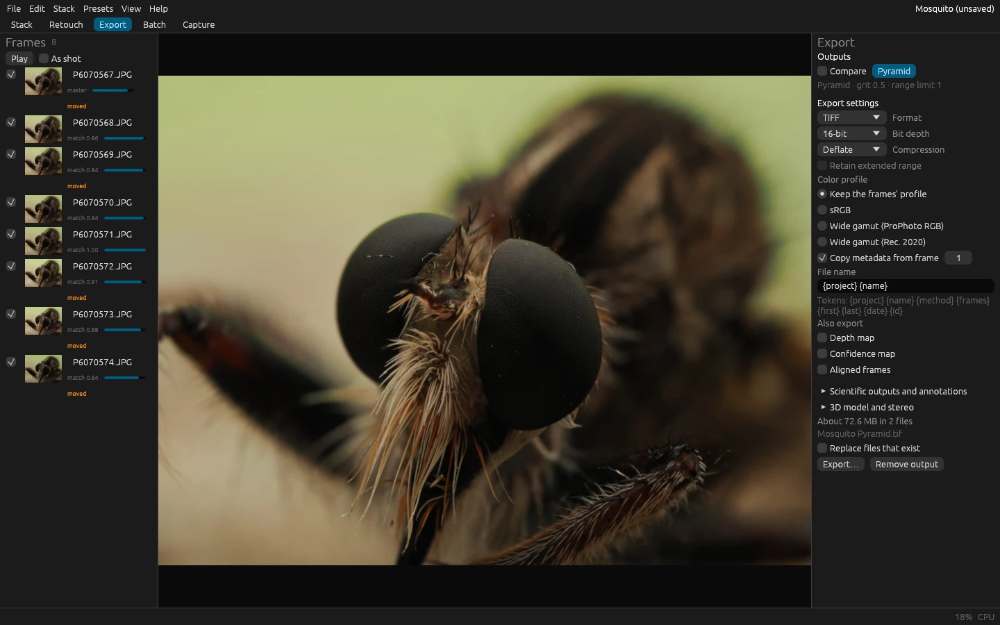

# Exporting, presets and preferences

## The Export tab

Every stack you make is an *output* of the project, kept until you remove it. The Export tab writes an output to a
file, with what goes with it. Pick the output in the list, check the settings, and press **Export…** to choose a
folder. The settings are the project's, saved with it, and a [preset](#presets) can carry them.



| Setting | Choices |
|---|---|
| **Format** | **TIFF** for editing; **PNG** for the web without loss; **JPEG** for sharing; **DNG** to develop the stack as a RAW file in a raw converter; **OpenEXR** for compositing, in 32-bit float |
| **Bit depth** | 16 bits keep smooth gradients through later editing; 8 bits are enough for a final picture; 32-bit float keeps every value and the extended range. Each format offers what it can hold |
| **Compression** | TIFF: Deflate or LZW (smaller, lossless) or none (opens everywhere). OpenEXR: ZIP, PIZ (noisy images) and others, all lossless, and half floats. DNG: lossless JPEG. JPEG: quality (90 to 95 to keep, 75 to 85 for the web) and color detail |
| **Color profile** | **Keep the frames' profile** (the default: what they were shot or exported in), **sRGB** (the safest for sharing), or a wide gamut (**ProPhoto RGB** or **Rec. 2020**) that keeps saturated colors for editing |
| **Copy metadata from frame** | The camera, lens, exposure, date, place and keywords of that frame (counted from 1 in the frame list), in the file |
| **File name** | The name without its extension; `{project}`, `{name}` (the output's), `{method}`, `{frames}`, `{first}`, `{last}` (the first and last frames' file names), `{date}` and `{id}` are filled in |
| **Also export** | A depth-map output's **depth map** and **confidence map**, as 16-bit gray TIFFs beside it; the **aligned frames**, each warped onto the output's canvas, as 16-bit TIFFs in a folder of their own, for retouching in other programs |

**Retain extended range** (32-bit float only) keeps the values the pyramid pushed beyond black and white, before they
were brought back into range. The tab shows the size the export will take, and the name of the main file; an export
that would replace a file stops and says which, unless **Replace files that exist** is on.

Every export also writes a JSON *sidecar* beside the image (`<file>.json`) that records the software version, every
setting and the inputs' hashes, from which `florastack-cli reproduce` makes the same image again.
[Scientific exports and annotations](scientific-exports.md) describes it, with the calibrated depth, the per-frame
contribution maps, the alignment CSV and the scale bars and labels of the tab's **Scientific outputs and
annotations** section; [3D reliefs and stereo](3d-stereo.md) the **3D model and stereo** section.

## Presets

A preset is a TOML file holding some of a project's settings, in four groups: **RAW develop**, **Alignment**,
**Stacking** and **Output**. The **Presets** menu applies one and saves the project's settings as one.

- **Built-in presets** start you off for common subjects: **Insect macro**, **Product shot**, **Landscape** and
  **Microscope**. Each one's tooltip says what it sets.
- **Apply a preset file…** applies a preset you saved or were given. Applying asks which of its groups to take, so you
  can take only a preset's output settings, for example.
- **Save as preset…** saves the project's settings. By default the file holds only what you changed from the defaults,
  so it layers over other settings when applied; **Every setting, the defaults too** saves all of them, for a preset
  that gives the same settings whatever the project had.

Presets layer: applying one changes only the settings it holds. A preset for your camera's RAW development and another
for your output format can be applied one after the other. The command-line tool takes a preset with `--preset FILE`,
or a built-in one as `--preset builtin:insect-macro` (`product-shot`, `landscape`, `microscope`).

A preset file looks like this; every key is optional:

```toml
[preset]
name = "Rail, 5x"
description = "Microscope objective on a rail: shift only, the pyramid with low grit."

[develop]
white_balance = "as-shot"

[align]
shift_x = true
shift_y = true
scale = false
rotation = false
framing = "common"

[stack.pyramid]
grit = 0.25

[output]
format = "tiff"
depth = "u16"
profile = "srgb"
```

The [engine commands](../reference/commands.md) `develop.set`, `align.set`, `stack.set` and `export.set` take the same
keys, and `develop.get`, `align.get`, `stack.get` and `export.get` show them all with their current values.

## Preferences

**File > Preferences…** (Ctrl+,) holds what belongs to this computer rather than to a project:

- **Memory**: how much memory stacking may use before it moves its work to disk; a quarter of the memory installed is
  suggested. [GPU, memory and the cache](performance.md) explains it.
- **Processing**: the GPU when it passes its test, the CPU only, or any GPU (software ones too, for testing); **Test the
  GPU** runs its self-test again, after a driver update for example.
- **Cache**: where temporary projects and stacking's work on disk go, how much each takes, and **Clean up**, which
  removes what crashed stacks left behind.
- **Autosave**: saves the project a few minutes after the first unsaved change (0 for never).
- **Appearance**: the theme (dark or light, also Ctrl+Shift+T) and the language.

FloraStack sends nothing anywhere: no telemetry, no usage statistics, no crash reports, no update checks.
