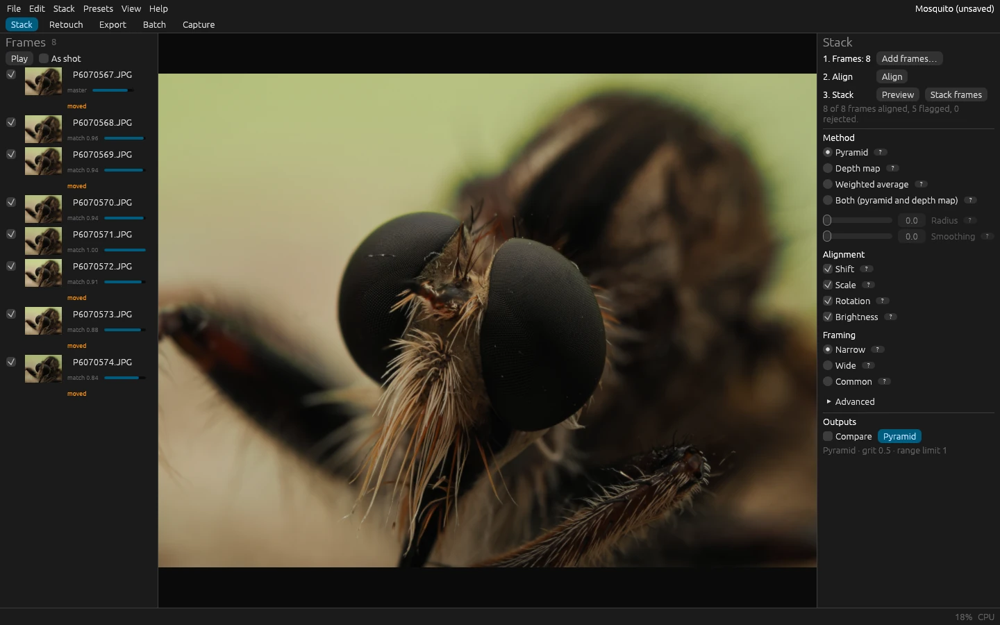
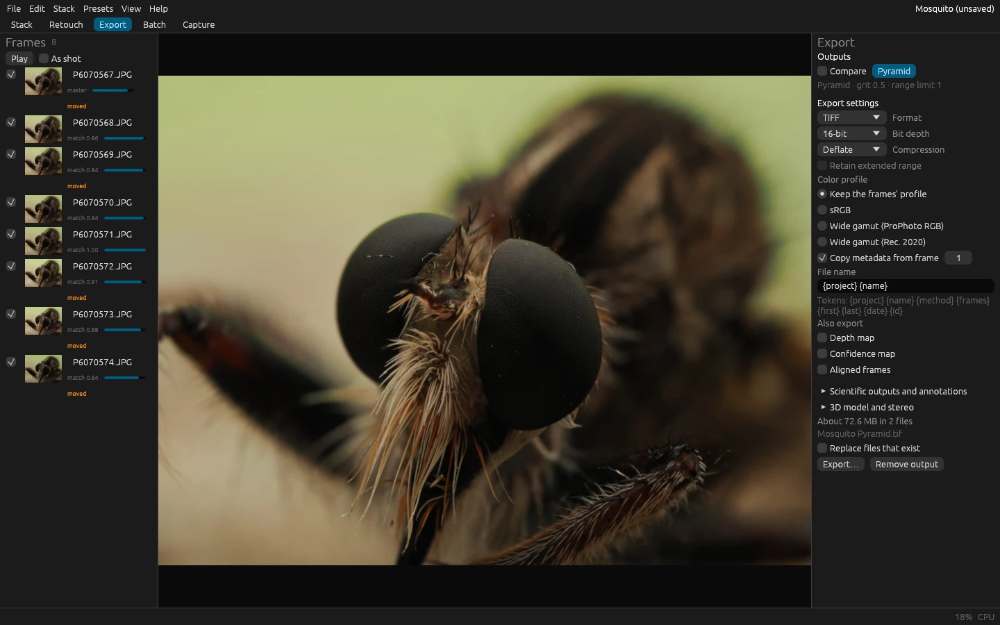

# Your first stack in five minutes

You need a stack: a series of photos of one subject, each focused a little farther than the one before, from the
nearest point you want sharp to the farthest. A camera's focus bracketing makes one, so does a focusing rail, and so
does turning the focus ring a little between shots on a tripod. [Shooting for focus stacking](shooting.md) says how
to make a good one; for a first try, any 5 to 30 photos of a small subject will do. RAW files, DNG, TIFF, JPEG, PNG,
WebP and OpenEXR all work.

## 1. Add the frames

Start FloraStack and drop the photos, or the folder that holds them, on its window. (Or **File > Add frames…**.) They
become the frames of a new, temporary project and appear in the frame list on the left, in the order of their file
names; the viewer in the middle shows the selected one.

The order matters: frames are stacked from one end of the focus range to the other, and file names from a camera or a
rail are in that order already. If yours aren't, see [out-of-order stacks](troubleshooting.md#out-of-order-stacks).

## 2. Align

Press **Align** in the Stack tab, on the right (or **Stack > Align frames**, or Ctrl+L; ⌘L on macOS). Alignment measures how
each frame moved, turned and changed scale against its neighbor, and corrects it; focusing changes a lens's
magnification a little, and even a tripod moves. It takes a few seconds for a handful of frames.

Each frame in the list then shows how well it matched its neighbor, from 0 to 1. A good stack scores above 0.9
everywhere. Frames flagged **out of focus** (the blurred ones at the ends), **moved** or **low score** are worth a
look; untick a frame to leave it out, and align again.

## 3. Stack

The Stack tab's method is **Pyramid** by default, the best all-rounder. As soon as the frames are aligned, a
quarter-size preview shows in the viewer: it takes a few seconds, and is made again whenever you change a setting.

Press **Stack frames** for the full-size result. It runs in the background, with its progress and the time left in the
top bar; you can keep changing settings and previewing meanwhile. The result appears in the **Outputs** list, under the
settings, and in the viewer.



Zoom to 100% (Ctrl+1, or **View > Zoom to 100%**) and look at the fine detail. If you see halos along edges, smeared
hairs or blotches, [Choosing a method](methods.md) explains what each method does well, and **Both** makes a pyramid
and a depth-map output to compare: tick **Compare** on two outputs to see them side by side or with a split line.

## 4. Export

Open the **Export** tab, pick the output, and press **Export…**: choose a folder, and the stacked image is written
there, as a 16-bit TIFF with the first frame's metadata unless you change the export settings. TIFF keeps everything for
editing; JPEG is for sharing. [Exporting, presets and preferences](export.md) explains the choices.



## 5. Keep the project, or not

The project holds the frames' alignment, every output and its retouching. Until you name it, it's temporary: **File >
Save as…** names it and puts it in a folder of your choice, as `<name>.florastack/`, which **File > Open project…**
opens again. Temporary projects that go unused for 30 days are offered for the trash the next time FloraStack starts.

A project refers to your photos where they are; it holds no copy of them. Keep the project folder with the photos, in
the same folder or one near it, and you can move both together, to another drive or another computer: the project
finds its frames by where they are from itself. When a project opens, FloraStack tells you which frames are missing
or have changed since you added them.

## The same from the command line

```sh
florastack-cli stack path/to/photos --out result.tif
```

aligns and stacks the photos in that folder by the pyramid method and writes a 16-bit TIFF. On Windows you can also
drag the photos onto `florastack-cli.exe` in Explorer: it stacks them with the default settings into
`<first photo>-stacked.tif`, beside them. [The command-line tool](../reference/cli.md) lists every option.

## Next

- **Help > Keyboard shortcuts** (F1) lists the shortcuts, and Ctrl+K (⌘K on macOS) opens the command palette, which
  runs any of FloraStack's [commands](../reference/commands.md) by name.
- [Retouching](retouching.md) repairs what no method gets right by itself, by painting from the frames.
- [Adjusting the image](adjusting.md) finishes it: tone, color and detail, for the whole image and within masks such as
  the subject or a range of its depth.
- [The Stack tab](stack-tab.md) explains every setting.
- [Shooting for focus stacking](shooting.md) makes the next stack easier to stack.
