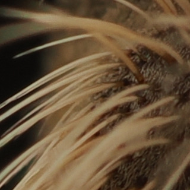
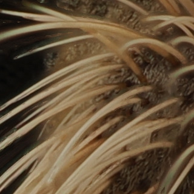
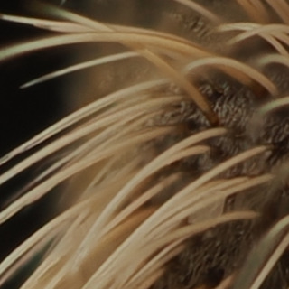
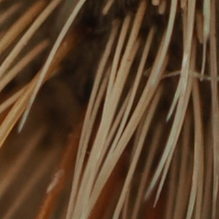
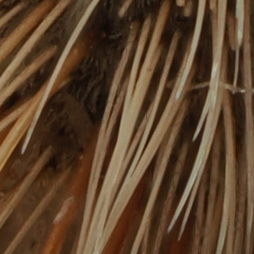
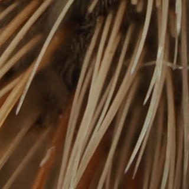
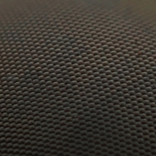
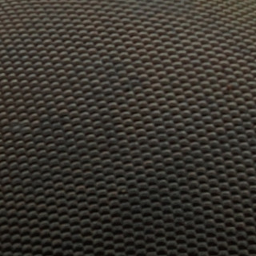
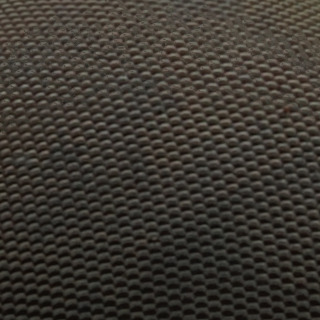
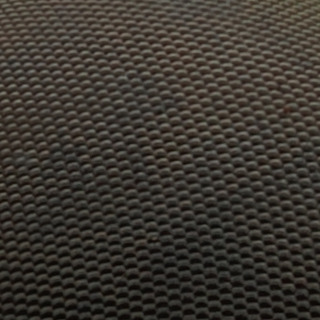

# Choosing a method

FloraStack merges a stack by one of three methods. They differ in how they decide which frame each part of the result
comes from, and so in what they get right and wrong. The Stack tab's **Method** chooses; **Both** makes a pyramid and
a depth-map output from the same frames, to compare them, or to [retouch](retouching.md) one from the other.

| | Pyramid | Depth map | Weighted average |
|---|---|---|---|
| How | The sharpest detail at every scale, from fine to coarse | Each pixel from the frame where it is sharpest | Every frame blended, each weighted by its sharpness |
| Best for | Hair, bristles, antennae: near and far detail that overlap | Smooth subjects and backgrounds; exact colors and tones | Quick results; simple subjects without fine overlapping detail |
| Weak spots | Can raise contrast and noise a little | Halos and smears where near and far detail meet | Softer; veils around out-of-focus edges |
| Settings | Grit, range limit, tone, levels, decisions | Radius, smoothing, contrast threshold | Radius, smoothing, power |
| Speed | Slowest on the CPU, fast on a GPU | Reads the frames twice | Fastest |

**Start with the pyramid.** It is the default, and the best all-rounder. Try the depth map when the pyramid makes
smooth areas noisy or shifts their tones, or when you need the depth map itself (for [3D](3d-stereo.md) or
[scientific exports](scientific-exports.md)). Use the weighted average for a quick look, or for subjects with no fine
overlapping detail.

## What they look like

These are crops at 100%, 320 pixels square and not scaled, of the same places in three 20-megapixel outputs of one
stack: 8 frames of an insect's head, shot in a second on an OM System OM-1 Mark II with a 60 mm macro lens at f/8, as
camera JPEGs. Beside each is the single frame that is sharpest at that place: what one photo can show. The places are
where the three methods' fine detail differs most, chosen by [the script that made the crops](../dev/docs.md#the-method-crops).

### Bristles over a dark background

| Sharpest frame (5 of 8) | Pyramid |
|---|---|
|  |  |
| **Depth map** | **Weighted average** |
|  |  |

In the single frame only some bristles are sharp. The pyramid has them all, crisp, with the dark background clean
between them. The depth map has them too, but where a near bristle crosses a far one it takes each pixel from one frame
or the other, and smears appear along some of them. The weighted average is softer, and a faint veil of out-of-focus
bristles lies over the background.

### Crossing bristles

| Sharpest frame (3 of 8) | Pyramid |
|---|---|
|  |  |
| **Depth map** | **Weighted average** |
|  |  |

The same, more so: the depth map's smudges sit between the bristles on the left, where the frames disagree about which
is sharpest.

### The compound eye

| Sharpest frame (3 of 8) | Pyramid |
|---|---|
|  |  |
| **Depth map** | **Weighted average** |
|  |  |

A curved, evenly textured surface: the single frame is sharp only in a band, and every method makes it sharp all
over. The depth map shows faint patches where its choice of frame changes; the pyramid and the average are even.

On this stack the pyramid is the one to keep. On a smooth subject, such as a flower's petals or a product's
surfaces, the depth map's untouched tones and lower noise can win instead: try **Both** and compare.

## Pyramid

The pyramid method splits every frame into layers of detail, from the finest (single pixels) to the coarsest (the
broad tones), and at each layer and each place keeps the detail of the frame with the most of it there. Rebuilt, the
layers give an image whose every detail comes from where it was sharpest, at every scale at once, which is why fine
structures in front of other fine structures come out right.

Its settings, under **Advanced**:

- **Grit** decides whether the finest detail comes from the single sharpest frame (higher: crisper texture) or a blend
  of the sharpest ones (lower: less speckled noise in smooth areas).
- **Range limit** holds each pixel within the brightness the frames have there, which stops halos and overshoot
  around edges. Leave it at 1 unless you want local contrast to rise.
- **Tone** says what happens to the few values the method pushes beyond white or black: compressed back smoothly (the
  default), clipped, or kept for a 32-bit file.
- **Decisions** by luminance (the default) or by channel; by channel can reduce color fringes, but may shift colors.

## Depth map

The depth-map method works out, for every pixel, in which frame it is sharpest (its *depth*), smooths that map so that
neighbors agree, and takes each pixel from the frames at its depth. Colors and smooth tones stay exactly as the frames
have them, and the depth map can be exported or turned into a 3D relief.

Where no frame stands out, such as a blurred background or a smooth surface, the sharpest frame is a guess, and
following noise there makes blotches. The **contrast threshold**, which the tab asks for before stacking, marks those
areas, whose depth is then filled in from the confident pixels around them: raise it until noise and smooth background
turn black in its picture, while the subject's detail stays visible.

**Radius** (how wide an area sharpness is measured over) and **smoothing** (how gradually it moves from one frame to
the next) trade fine detail against seams and noise. [The Stack tab](stack-tab.md) explains each.

## Weighted average

The weighted average blends every frame at every pixel, weighting each by how sharp it is there. It is the fastest
method and makes no halos of its own, but out-of-focus frames always contribute a little, which softens the result and
leaves veils around a subject's edges. **Power** sets how strongly the sharpest frame wins.

## Previews and outputs

Every method can preview at a quarter of the size in a few seconds, and each full stack is kept as an output with the
settings it was made with, so trying another method or setting never loses a result. For very deep stacks, of
hundreds of frames, [slabbing](slabbing.md) stacks groups of frames first and then the groups.
