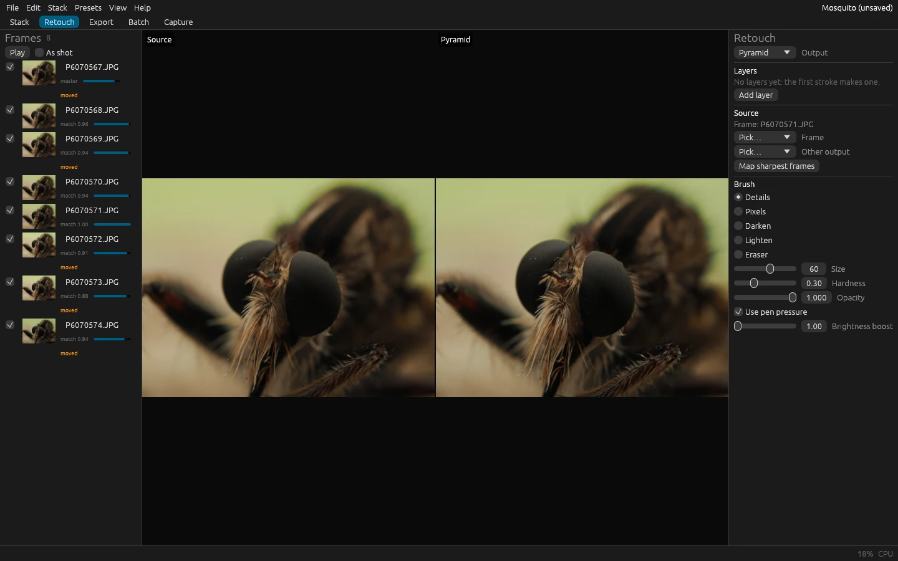

# Retouching

Stacking can't always tell which frame is right: a bristle in front of a blurred background, a halo along an edge, a
hair that moved between frames. The Retouch tab fixes those by hand, painting from a frame (or from another output)
onto the result. Retouching is non-destructive: each stroke is a record kept in the project, layer by layer, and the
result is the output with its strokes painted over it, so strokes can be undone, layers hidden, and the work picked up
again in a later session.

## A first retouch, step by step

1. **Open the output.** Stack the frames, then open the **Retouch** tab: it opens the output selected in the outputs
   list, or the newest. The output is on the right; the source, the image strokes paint from, will be on the left. The
   two views zoom and pan together.
2. **Find a flaw.** Zoom in on the output with the mouse wheel, and pan with the middle or right button (or Space and
   the left button). Look along edges where something near crosses something far: a smeared bristle, a halo, a
   doubled hair.
3. **Pick the source.** Ctrl+click the flaw (⌘-click on macOS): the source becomes the frame where that point is
   sharpest, and the left view shows it. A depth-map output knows its sharpest frames already; for a pyramid or
   weighted-average output, press **Map sharpest frames** once first, which measures the frames' focus and keeps the
   map with the output. Check the left view: the bristle should be sharp there. If it isn't, pick a neighboring frame in
   **Frame**.
4. **Choose the brush.** **Details**, the default, is the brush for most repairs: it paints the source's detail with
   its brightness and color matched to the output, so that the stroke blends in. For a dark bristle over a light
   background, **Darken** paints only where the source is darker and leaves the background between the bristles
   alone; **Lighten** does the opposite.
5. **Size it.** `[` and `]` make the brush smaller and larger; its circle shows in both views, so you can see what a
   stroke will bring before you paint. Make it a little wider than the flaw.
6. **Paint.** Drag over the flaw on the output. The stroke shows as you draw, and becomes one undo step when you let
   go: Ctrl+Z takes it back, Ctrl+Shift+Z brings it again.
7. **Group and compare.** The first stroke makes "Layer 1". **Add layer** starts another, for the next group of
   repairs; untick a layer to hide its strokes and see the output without them.
8. **Keep it.** Save the project (Ctrl+S): the strokes are part of it. Exporting the output (the Export tab) writes it
   with its visible strokes.

### Painting from another output

A stack made with **Both** has a pyramid and a depth-map output of the same frames. Where one method is right and
the other wrong (the pyramid's crisp bristles, the depth map's smooth background), retouch one from the other: pick the
other output under **Other output** as the source and paint, with **Pixels** to copy it exactly or **Details** to
blend it. A slabbed stack's slabs are outputs too, each near in focus to its part of the subject. Only outputs with the
same framing can be a source.

## How it works

- **Two views.** The source is on the left and the output being retouched on the right, with zoom and pan locked
  together. The brush's circle shows at the same point in both.
- **The source.** Pick a frame or another output in the panel. Or Ctrl+click a point of the output, and the source
  becomes the frame where that point is sharpest. With **Follow the sharpest frame** on, resting the pointer on a point
  does the same.
- **Painting.** Drag on the output to paint; the stroke shows as you draw it and becomes one undo step when you let go.
  Pan with the middle or right button, or with Space and the left button; zoom with the wheel. `[` and `]` make the
  brush smaller and larger.
- **Layers.** Strokes go into the layer picked in the panel, or the top one; the first stroke makes "Layer 1". Hide a
  layer to see the output without its strokes.

## Brushes

- **Details** (the default) paints the source's detail with its brightness and color matched to the output's, so that
  a frame a little brighter or tinted than the stack paints seamlessly. Its edge is hard where there is fine detail (so
  a hair comes through whole, without a ghost) and as soft as its hardness elsewhere (so it blends).
- **Pixels** paints the source exactly as it is.
- **Darken** and **Lighten** paint only where the source is darker (or lighter) than the result: a dark bristle over a
  light background, without touching the background between the bristles.
- **Eraser** brings back the output as it was stacked.

Every brush has a size (its diameter, in pixels of the output), a hardness (how much of it paints fully before its edge
fades) and an opacity. With **Use pen pressure** on, a pen's pressure makes the brush smaller where the system reports
it (Windows). The **Brightness boost** shows both views brighter for working in dark regions; it changes only what you
see.

## What is kept

- Strokes are kept in `project.json`, each with its brush, settings, source and the pointer's path, in pixels of the
  output. Painting them again over the same images gives the same pixels, bit for bit, which is what makes undo exact
  and later sessions reliable.
- When the project is saved (and when another output is opened for retouching), the retouched result is cached with
  the output, so that opening it again needs no recomputation. Frames used as sources are cached too, warped onto the
  output's canvas, so that they are read rather than decoded again.
- Exporting a retouched output (Export tab, `output.save`) writes it with its visible strokes.
